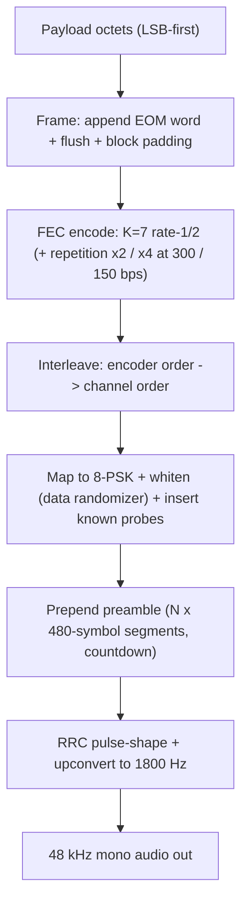
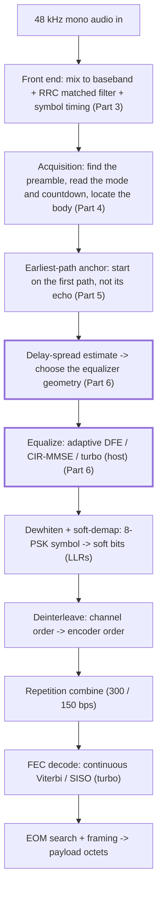

# Start here

This repository is the transmit side of a MIL-STD-188-110A/B serial-tone HF modem
(everything between a message and the audio a radio puts on the air) and the first
stages of its receiver: the front end, acquisition and the earliest-path anchor. This page is the map. It shows the big picture, walks the
transmit chain in the order the data flows, lists which file does what, and suggests a
reading order. It closes with the receive side so far and a look ahead at the next
stage.

The worked example throughout the series is 600 bps with the long interleaver ("600L").
[`tests/tx_demo.cpp`](../tests/tx_demo.cpp) walks a short message through that mode and
prints the values at each step; build it (see the [README](../README.md)) and keep its
output beside you.

## The big picture: bytes to audio

Every stage exists so that a receiver can undo what the channel will do to the signal.
The code adds redundancy; the interleaver turns a fade into scattered errors the code
can fix; the probes give the receiver known symbols to measure the channel with; and
the preamble tells it that a transmission is starting, and in which mode.

## Guided tour: the transmit chain

Follow the diagram top to bottom. The transmitter is a thin orchestrator over the body
waveform module, and every buffer it touches belongs to the caller.

1. **Plan and orchestrate.** Size the whole transmission up front, then run the chain
   into the caller's audio buffer.
   → [transmitter explainer](../modem/m110a/transmitter-and-dsp-explainer.md) ·
   [`transmitter.cpp`](../modem/m110a/transmitter.cpp)
2. **Frame.** Append the 32-bit end-of-message (EOM) word and the 144-bit flush, then
   pad to a whole number of blocks.
   → [body waveform explainer](../modem/m110a/body-waveform-and-scrambler-explainer.md) ·
   [`body_waveform.cpp`](../modem/m110a/body_waveform.cpp)
3. **FEC encode.** The K=7, rate-1/2 convolutional encoder, with repetition at 150 and
   300 bps; one continuous encoder runs across every block.
   → the worked example in the body waveform explainer ·
   [`convolutional_k7.cpp`](../modem/common/fec/convolutional_k7.cpp)
4. **Interleave.** The standard's matrix interleaver: load it one way, read it out
   another, so a fade on the air lands as scattered bits in the code.
   → [demapper and deinterleaver explainer](../modem/m110a/demapper-and-deinterleaver-explainer.md) ·
   [`interleaver.cpp`](../modem/m110a/interleaver.cpp)
5. **Map, whiten, and insert probes.** Bits become points on the 8-PSK circle through a
   modified-Gray map; the data randomizer whitens every body symbol; known probe
   symbols are inserted into every frame.
   → the body waveform and demapper explainers ·
   [`demapper.cpp`](../modem/m110a/demapper.cpp),
   [`scrambler.cpp`](../modem/m110a/scrambler.cpp),
   [`body_waveform.cpp`](../modem/m110a/body_waveform.cpp)
6. **Preamble and render.** Prepend the countdown preamble, shape every symbol with a
   root-raised-cosine pulse, and up-convert to the 1800 Hz carrier.
   → the body waveform explainer, and section 8 of the transmitter explainer ·
   [`body_waveform.cpp`](../modem/m110a/body_waveform.cpp),
   [`timing_recovery.cpp`](../modem/common/dsp/timing_recovery.cpp) (the pulse)

Underneath every stage sit the mode tables in
[`modem/common/waveform/`](../modem/common/waveform/), the single authority on what each
rate and interleaver setting looks like, and the shared vocabulary in
[`modem/common/`](../modem/common/): the one scalar type `Real`, the unit types, and the
`Status` and `Result` error values.

## Module map

What ships today, and where each piece is explained.

| Stage or role | Source, under `modem/` | Explained in |
|---|---|---|
| Transmit orchestration | `m110a/transmitter.*` | transmitter explainer |
| Body burst: block plan, preamble, encode, framing, render | `m110a/body_waveform.*` | body waveform explainer |
| Scramblers and the modified-Gray map | `m110a/scrambler.*` | body waveform explainer |
| 8-PSK mapping | `m110a/demapper.*` | demapper and deinterleaver explainer |
| Interleaver | `m110a/interleaver.*` | demapper and deinterleaver explainer |
| K=7 convolutional encoders | `common/fec/convolutional_k7.*` | body waveform explainer (worked example) |
| Mode tables | `common/waveform/waveform.*` | body waveform explainer |
| Root-raised-cosine pulse: the transmitter's table, the receiver's design | `m110a/body_shaping_pulse.hpp` (made by `tools/generate_shaping_pulse.py`); `common/dsp/timing_recovery.*` | body waveform explainer; transmitter explainer, section 8 |
| Receive front end: mix down, matched filter, symbol timing | `m110a/body_audio_stream_frontend.*` | the audio front end article and explainer |
| Carrier tracking | `common/dsp/timing_recovery.*` | the audio front end article and explainer |
| Acquisition: find the burst, read its mode and countdown | `m110a/synchronization.*` | the acquisition article and explainer |
| The front end's phase search and rate integrator | `m110a/body_audio_stream_frontend.*` | the acquisition article; the audio front end explainer |
| Earliest-path anchoring: the first path, not the strongest | `m110a/synchronization.*` | the first path article; the acquisition explainer |
| Shared vocabulary: `Real`, units, status and results, bit spans | `common/*`, `common/units/*` | the comments in each header |

The demo and the golden-waveform test are [`tests/tx_demo.cpp`](../tests/tx_demo.cpp);
the transmit chain's unit tests are
[`tests/transmit_chain_tests.cpp`](../tests/transmit_chain_tests.cpp); the front end's demo and unit tests are [`tests/front_end_demo.cpp`](../tests/front_end_demo.cpp)
and [`tests/front_end_tests.cpp`](../tests/front_end_tests.cpp), and acquisition's are
[`tests/acquisition_demo.cpp`](../tests/acquisition_demo.cpp) and
[`tests/acquisition_tests.cpp`](../tests/acquisition_tests.cpp), and the first path's are
[`tests/first_path_demo.cpp`](../tests/first_path_demo.cpp) and
[`tests/first_path_tests.cpp`](../tests/first_path_tests.cpp), on the article's recordings
(configure with `-DMODEM_ARTICLE_DATA=ON`); each pair shares the
walkthrough steps in [`tests/walkthrough/`](../tests/walkthrough/) and the test bench in
[`tests/support/`](../tests/support/). The runner, [`tests/runner.cpp`](../tests/runner.cpp),
runs every stage so far end to end on your own message or a WAV file; its tests are
[`tests/runner_tests.cpp`](../tests/runner_tests.cpp).
[CONTRIBUTING](../CONTRIBUTING.md) covers the quality gates. Where the standard left a
decision to the implementer, the call made is recorded in
[standard interpretations](../modem/m110a/standard-interpretations.md).

The headers also declare the rest of the receiver's functions (the demappers, the
deinterleavers, the Viterbi decoders, the body decoder, and a whole-buffer matched filter
and timing loop) with their design notes. They are not implemented yet; they arrive with
the receiver articles.

## Reading order

1. **This page**, then build and run `tx_demo` and keep its output open. The
   transmit chain's tests, `transmit_chain_tests "[walkthrough]" --order decl`, print the
   same values stage by stage, and each one can be stepped through in the debugger.
2. The [transmitter explainer](../modem/m110a/transmitter-and-dsp-explainer.md), then
   [`transmitter.cpp`](../modem/m110a/transmitter.cpp): short and linear, one function
   to plan and one to render.
3. The [body waveform explainer](../modem/m110a/body-waveform-and-scrambler-explainer.md):
   the burst structure and the block plan that sizes everything. Read it early; every
   other stage is framed by it.
4. The [demapper and deinterleaver explainer](../modem/m110a/demapper-and-deinterleaver-explainer.md):
   how the coded bits are shuffled and placed on the constellation.
5. The [standard interpretations](../modem/m110a/standard-interpretations.md): the
   judgment calls.
6. The [audio front end article](articles/04-audio-front-end.md), then its
   [explainer](../modem/m110a/audio-front-end-explainer.md). Build and run
   `front_end_demo` and keep its output open, as with `tx_demo`; each step it prints is one
   function in [`tests/walkthrough/front_end_steps.cpp`](../tests/walkthrough/front_end_steps.cpp),
   which [`tests/front_end_tests.cpp`](../tests/front_end_tests.cpp) also checks. Set a
   breakpoint in a step and step through it.
7. The [acquisition article](articles/05-acquisition.md), then its
   [explainer](../modem/m110a/synchronization-and-acquisition-explainer.md), with
   `acquisition_demo` running the same way. Then run `runner` on a message of your own.
8. The [first path article](articles/06-first-path.md), with `first_path_demo` running on the
   article's recordings (configure with `-DMODEM_ARTICLE_DATA=ON`), then the acquisition
   explainer's sections on the anchoring.

Each explainer follows a common shape: a 50,000-foot view, a 5th-grade version, where
the module sits in the pipeline, a function-by-function walkthrough, a small worked
example (illustrative, not a compliance trace), what goes wrong, what to watch while
debugging, and notes for maintainers.

Then do what the [transmit-chain article](articles/03-transmit-chain.md) asks: open the
standard beside the code and check the numbers yourself.

## The receive side so far, and next: the equalizer

The transmitter is the easy half; everything about its signal is known in advance. The
receiver starts with none of that. Here is the receive chain at the level the
introduction describes it. The front end, acquisition and the earliest-path anchor are here
now; the delay-spread estimate and the equalizer are next.

The [audio front end article](articles/04-audio-front-end.md) covers the first stage.
[`body_audio_stream_frontend.cpp`](../modem/m110a/body_audio_stream_frontend.cpp) mixes
the 1800 Hz carrier down, filters, and finds and keeps each symbol's sampling instant.
`CarrierTracker`, in [`timing_recovery.cpp`](../modem/common/dsp/timing_recovery.cpp), is
the loop that removes what is left of the carrier's phase and frequency once the
equalizer gives it decisions. The [acquisition article](articles/05-acquisition.md)
covers the second stage. [`synchronization.cpp`](../modem/m110a/synchronization.cpp) finds
the preamble in the front end's symbols, measures the carrier offset, reads the mode and
the countdown, and works out where the body starts; the front end gained a phase search
and a rate integrator for the clock. On one path that is the whole story. The
[first path article](articles/06-first-path.md) covers two: each path delivers its own copy
of the preamble, and the receiver anchors on the first within the equalizer's reach, not
the strongest, even when the scan formed no group for it. Think about these before the
next article:

1. The echo arrives 12 symbols behind the anchor. How many taps half a symbol apart does
   an equalizer need to reach it, and what sets that number before training?
2. The known symbols after each frame of data are 16 or 20 long. Why does that bound how
   long a channel the equalizer can follow?
3. When one path fades, what should happen to the equalizer's taps for it, and how fast
   do they have to move to follow a 5 Hz fade?
